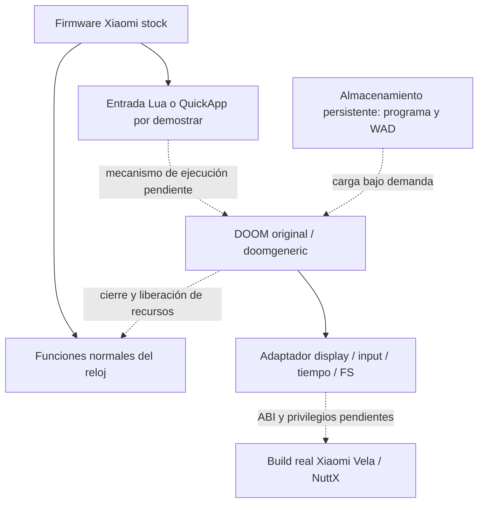

# Arquitectura propuesta

Estado: diseño condicionado por capacidades aún no demostradas. El firmware stock y las funciones normales tienen prioridad. [Evidencia actual](evidence-matrix.md).



La línea discontinua marca una dependencia no validada del objetivo físico: todavía no existe un adaptador DOOM para RW4. En el emulador S3 sí se construyó un [puente Lua↔C](lua-native-bridge-emulator.md) con carga bajo demanda, eventos y descarga desde EXIT. Ni el host Windows AMD64 ni un ELF del simulador determinan la ISA del RW4.

## Adaptador futuro

Checkpoint actual R62: [UI produce máscaras y worker las consume](native-worker-input-emulator.md), mientras presenta frames por [el camino R61](native-worker-frame-emulator.md). Ring SPSC32/epochs; releases antes de presses en C, ack neutral antes de resume. No hay aún DG_GetKey ni engine: se validaron transporte y lifecycle. Dos buffers C inmutables para el lector, copias tmpfs y Image desde UI; ningún puntero de módulo retenido por LVGL. STOP con FIRE mantenido y cierre/reentrada limpian, sin join/sleep UI. Siguiente: WAD legítimo/read validation y después adaptación del motor. ABI/privilegios del objetivo físico siguen pendientes.

Checkpoint previo completado: hello C por insmod/rmmod en el emulador, enlazado a su imagen exacta [resultado](hello-native-emulator.md). No construye aún los puentes de display/input/tiempo/FS del diagrama ni determina la ABI física RW4.

Display incremental completado: [patrón RGB565 y retorno a stock](native-display-emulator.md) mediante framebuffer compartido del emulador. Antes de usar ese camino para un port interactivo, resolver ownership/presentación y entrega de input; la prueba temporal no constituye el adaptador DOOM.

Camino actual en emulador: [frames dentro de nuestra página LVGL](native-frame-loop-emulator.md), dos slots tmpfs y un Timer Lua; invalida cache desde el caller UI y reutiliza nombres. Pausa y limpieza probadas en300 frames y reentrada, sin escribir directamente el framebuffer global. No es todavía adaptador Doom ni prueba prolongada de memoria o rendimiento físico.

Usar las funciones reales declaradas por [doomgeneric.h](https://github.com/ozkl/doomgeneric/blob/dcb7a8dbc7a16ce3dda29382ac9aae9d77d21284/doomgeneric/doomgeneric.h): inicialización, frame, espera, ticks, eventos de tecla y título opcional. Conservar motor, renderer y gameplay. `doomgeneric_Create`/`doomgeneric_Tick` articulan el ciclo del port; su ejemplo infinito necesita una estrategia de cierre antes del hardware.

Display: comparar LVGL frente a framebuffer después de conocer acceso, ownership del display, formato y threading. LVGL Lua no demuestra símbolos C exportados. Framebuffer directo puede competir con la UI stock. Inicialmente un patrón; luego frame DOOM a 320×200 si el motor se configura así. Sus defaults upstream actuales son 640×400. En 390×450, decidir escalado/letterboxing tras validación. Un frame de 320×200×4 ocupa 256,000 bytes; uno de 390×450×4 ocupa 702,000 bytes. Son cálculos de buffers, **no mediciones de consumo total** ni demostración de que Doom cabe.

Input: [cola C de32 eventos y cancelación probadas en emulador](native-controls-emulator.md), sin motor. Adaptador futuro de press/release hacia teclas de Doom, coordenadas escaladas y liberación de teclas al cancelar gesto/cerrar. Giro, avanzar y fire primero. [Propuesta de controles](controls.md): zonas grandes, un dedo, avanzar y girar combinados; ergonomía aún no validada. Corona y más controles después de una API demostrada. Tiempo: reloj monotónico y sleep medidos, no reloj de pared. FS: acceso aleatorio al WAD, errores/cuotas y ownership de archivos. Audio excluido del primer milestone.

Tiempo R56: [CLOCK_MONOTONIC y esperas C medidos](native-time-emulator.md) en tarea NSH separada, panel stock activo. No dormir dentro del callback UI ni confundir este ensayo con scheduling del motor. El futuro port debe calcular tiempo transcurrido real; las esperas1ms variaron y aún no hay backend DG_GetTicksMs/DG_SleepMs integrado.

## Persistencia frente a residencia

FS R57: [open/read/lseek/close probados sobre fixture tmpfs](native-fs-emulator.md), con posiciones64, EOF y errores. No es persistencia: tmpfs se pierde al reset. R58 [lectura stdio y consulta de longitud](native-stdio-emulator.md) también pasan con fixture propio; EOF después de seek requiere atención/clearerr. Ejecución del motor, su tarea/scheduling y WAD real siguen pendientes.

R59: [worker finito desde NSH](native-task-emulator.md) valida creación, parada cooperativa y join antes de unload, con UI stock respondiendo. R60: [launcher/worker](native-launcher-emulator.md) separa initializer NSH y creación desde UI28; detach y stop/poll permiten EXIT sin join/sleep en UI. Descarga exige reason + PID ausente y referencias cerradas. El motor podrá necesitar una tarea separada porque TryRunTics espera; no se ha integrado. El worker no llama LVGL; sincronización input/frame sigue pendiente.

Ruta conceptual, **no una ruta aprobada en RW4**:

```text
storage: /data/<app-owned-dir>/doom.elf
         /data/<app-owned-dir>/doom1.wad
open:    loader copia o mapea el programa; inicia el motor
close:   exit/unload; libera RAM y recursos de UI/input
reopen:  vuelve a cargar los archivos persistentes; no necesita PC
```

Almacenar un archivo no requiere mantenerlo residente. Tampoco convierte la carga en sandbox. Las APIs `internal://files` de QuickApp documentan otra abstracción de storage; no asumir que equivalen a una ruta POSIX accesible para C. La carga persistente, el launcher y los savegames requieren pruebas independientes.

## Gate de integración

Antes de doomgeneric: ejecución mínima comprendida, display, timers, touch, FS y cierre limpios demostrados en emulador. Antes de C: ISA/ABI/config/exports/privilegios conocidos. Antes de RW4: evidencia M2315W1 y revisión del [plan físico](physical-device-plan.md). No se justifica escalación de privilegios mientras no exista una restricción concreta.

R64: [motor real compilado para inspección](doom-build-audit.md). Interponer shim libc con FILE opaco, recursos contabilizados, writes bloqueados y salida cooperativa. I_Quit de upstream no sale con ORIGCODEoff; no enlazar exit/system de escritorio. UI/worker/slotownershipR62 permanece base, ninguna ruta de motor se ejecutó todavía. Recarga de módulo limpio por sesión; persistencia de archivos separada de RAM.

R65: [runtime propio y build con él](doom-runtime-emulator.md). El worker ejecutará el motor dentro de rw4_runtime_run: memoria registrada/presupuesto, FILE wrappers de lectura, logs acotados y salida al cleanup mediante setjmp/longjmp del guest exacto. STOP externo solo marca un atomic; el owner debe observarlo en polls/DG. I_Quit/I_Error generan salida sin callbacks de escritura upstream. Cada sesión deberá recargar el módulo, no conservar punteros/globales después de liberar recursos. Primer frame real y adaptación DG siguen pendientes; recursos/exit del fixture ya pasan.
