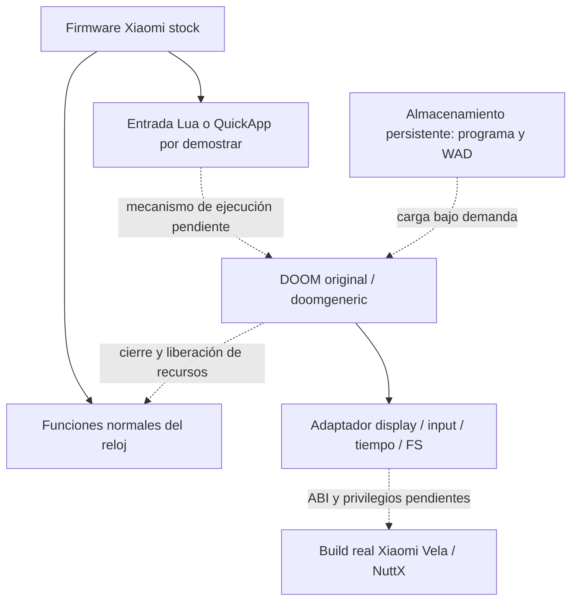

# Arquitectura propuesta

Estado: diseño condicionado por capacidades aún no demostradas. El firmware stock y las funciones normales tienen prioridad. [Evidencia actual](evidence-matrix.md).



La línea discontinua marca una dependencia no validada; no se ha construido ninguno de esos puentes nativos. El emulador S3 permite investigar conceptos, Lua, UI y APIs. Ni el host Windows AMD64 ni un ELF del simulador determinan la ISA del RW4.

## Adaptador futuro

Usar las funciones reales declaradas por [doomgeneric.h](https://github.com/ozkl/doomgeneric/blob/dcb7a8dbc7a16ce3dda29382ac9aae9d77d21284/doomgeneric/doomgeneric.h): inicialización, frame, espera, ticks, eventos de tecla y título opcional. Conservar motor, renderer y gameplay. `doomgeneric_Create`/`doomgeneric_Tick` articulan el ciclo del port; su ejemplo infinito necesita una estrategia de cierre antes del hardware.

Display: comparar LVGL frente a framebuffer después de conocer acceso, ownership del display, formato y threading. LVGL Lua no demuestra símbolos C exportados. Framebuffer directo puede competir con la UI stock. Inicialmente un patrón; luego frame DOOM a 320×200 si el motor se configura así. Sus defaults upstream actuales son 640×400. En 390×450, decidir escalado/letterboxing tras validación. Un frame de 320×200×4 ocupa 256,000 bytes; uno de 390×450×4 ocupa 702,000 bytes. Son cálculos de buffers, **no mediciones de consumo total** ni demostración de que Doom cabe.

Input: cola de press/release hacia teclas de Doom, coordenadas escaladas y liberación de teclas al cancelar gesto/cerrar. Giro, avanzar y fire primero. Corona y más controles después de una API demostrada. Tiempo: reloj monotónico y sleep medidos, no reloj de pared. FS: acceso aleatorio al WAD, errores/cuotas y ownership de archivos. Audio excluido del primer milestone.

## Persistencia frente a residencia

Ruta conceptual, **no una ruta aprobada en RW4**:

```text
storage: /data/<app-owned-dir>/doom.elf
         /data/<app-owned-dir>/doom1.wad
open:    loader copia o mapea el programa; inicia el motor
close:   exit/unload; libera RAM y recursos de UI/input
reopen:  vuelve a cargar los archivos persistentes; no necesita PC
```

Almacenar un archivo no requiere mantenerlo residente. Tampoco convierte la carga en sandbox. Las APIs `internal://files` de QuickApp documentan otra abstracción de storage; no asumir que equivalen a una ruta POSIX accesible para C. La carga persistente, el launcher y los savegames requieren pruebas independientes.

## Gate de integración

Antes de doomgeneric: ejecución mínima comprendida, display, timers, touch, FS y cierre limpios demostrados en emulador. Antes de C: ISA/ABI/config/exports/privilegios conocidos. Antes de RW4: evidencia M2315W1 y revisión del [plan físico](physical-device-plan.md). No se justifica escalación de privilegios mientras no exista una restricción concreta.
