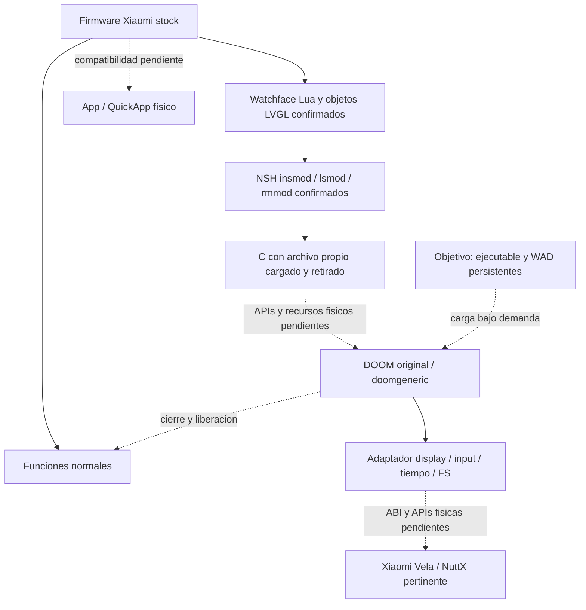

# Arquitectura

R217: [NativeLog usa cinco APIs de archivo desde C y se retira](native-log-physical-result-r216.md).
Lua escribe marca→insmod→C lee marca/escribe mensaje propio→Lua comprueba mensaje
y registro→rmmod→ausencia/limpieza. Usuario confirma cinco verdes y navegación/
cambio conservados. Contrato limitado a payload/contexto2.2.86; display, timers,
memoria y aislamiento nativos siguen pendientes. Siguiente PC: imagen generada
por C presentada desde Lua/LVGL; no framebuffer directo requerido por esa prueba.

R204: [C mínimo físico cargado/retirado y retorno habitual confirmados](first-c-corrected-physical-result-r203.md).
Ruta demostrada: paquete instalado→watchface Lua→NSH insmod→init C→lsmod→rmmod.
El archivo se conserva con la esfera, el módulo deja de estar registrado. No
imports, tareas o API nativa de display/input/FS usados en este candidato.

R182: Lua/objetos LVGL propios confirmados en M2315W1/2.2.86,texto Label ausente.
R183: [texto LVGL no es requisito del renderer Doom](adr/0004-lvgl-labels-are-not-a-doom-rendering-gate.md).
R73: [Doom persistente en S3 emulado](doom-persistence-emulator.md),carga/salida/reapertura.
El port C de Doom sigue condicionado por ABI completo,APIs,privilegios,RAM y recovery.
[Matriz](evidence-matrix.md).

## Objetivo físico condicionado



Dependencias discontinuas sin validar en RW4. Ni host Windows AMD64 ni emulador Cortex-A determinan ISA del BES2700iBP. Primer inicializador confirmado, sin adaptador Doom nativo aprobado para hardware.

## Implementación ejecutada en emulador

`experiments/doom-ui/adapter.c` implementa DG_Init, DrawFrame, SleepMs, GetTicksMs, GetKey y título. Motor original fijado a dcb7a8dbc7a16ce3dda29382ac9aae9d77d21284; fuentes intactas, overlay I_Quit/I_Error para salida local. Sin sonido ni reimplementación de renderer/gameplay.

Lua/UI28 crea worker detached con stack32KiB después de retornar initializer NSH. Touch de su página escribe máscaras al driver propio. Ring SPSC32/epochs transfiere cambios; worker genera releases antes de presses en cola64 y DG_GetKey alimenta eventos originales. No lectura de /dev/input0 para controlar Doom ni intercepción del input stock.

DG_DrawFrame convierte320×200 BGRX a RGB565LE; dos slots C inmutables para lector. Stream por descriptor con EOF; Lua Timer50ms (R71) cierra descriptor, invalida cache en UI y escribe uno de dos archivos tmpfs. LVGL Image muestra x35/y40. Worker no llama LVGL; Timer no retiene callbacks nativos y LVGL no guarda punteros al módulo. Framebuffer global pertenece a UI stock.

Transporte inicial R67: aproximadamente5frames/s. [R71](doom-50ms-emulator.md):17,45entregas/s y12,67-13,55cambios visibles/s observados durante giros; motor aproximadamente35tics/s. Callbacks de dibujo, frames producidos y presentaciones son contadores distintos. Sin corrección de aspecto; controles debajo. [Layout](controls.md).

Runtime R65:128reservas/8streams/payload8MiB, owner worker único, FILE opacos de lectura del WAD fijo, logs acotados, writes/shell del motor denegadas. No sandbox FLAT. Peak tracked~6.28MiB excluye estáticos/stack/loader/libc/Lua/LVGL/cache/tmpfs. [Mediciones](doom-ui-emulator.md).

## Pausa y salida

Pausa invalida epoch, solicita releases; worker llega al límite entre Ticks, procesa KEYUP y confirma neutralidad antes de esperar sin Tick. DG descuenta pausa para evitar catch-up. RESUME explícito/contacto nuevo. Menú R67 y [panel stock R68](doom-focus-emulator.md) probados con motor real; volver exige RESUME. Pérdida de foco con acción mantenida pendiente.

EXIT elimina Image/invalida caches en UI, marca STOP y espera con Timer. Owner observa STOP en polls DG/runtime y vuelve a cleanup; no join/sleep UI. Unload exige cero referencias/lectores/productor/input, completion y PID ausente. Fallos retienen módulo. Finalizador Lua solo stop/retención; reentrada UI recoge caches/unload. [R69](doom-close-emulator.md) demuestra cierre normal sin EXIT con el motor activo y recogida al reentrar; crash o terminacion forzada sin garantia.

Cada sesión recarga ELF para restaurar globals. Liberar reservas no restablece motor. Límite120s real incluidas pausas/10000Ticks/E1M1; no hard watchdog/crash recovery. Saves/config/audio deshabilitados.

## Persistencia frente a RAM

Watchface/ELF/WAD en /data/app/watchface/market/365799903; assets en doom/. START verifica ELF y copia WAD por chunks32768bytes/Timer50ms a /tmp/rw4-doom1.wad, despues insmod del ELF persistente. EXIT unload/elimina tmp, conserva /data. R73 verifica reapertura despues de reset sin push. FNV no autentica codigo; instalacion/readbacks SHA256. Cancelar con EXIT o panel evita carga C.

Persistencia demostrada en S3 emulado; ruta equivalente no aprobada en RW4:

```text
storage: /data/<directorio propio>/doom.elf
         /data/<directorio propio>/doom1.wad
open:    cargar ejecutable y WAD; iniciar motor
close:   exit/unload; liberar RAM y recursos UI/input
reopen:  recargar desde almacenamiento, sin PC
```

Archivos persistentes no exigen residencia continua. RAM-only no significa sandbox. internal://files de QuickApp no demuestra ruta POSIX para C ni bridge nativo. Launcher/registro/saves requieren pruebas independientes.

## Gates

Ejecución/display/input/tiempo/WAD/motor y dos salidas limpias demostrados en emulador. [R68](doom-focus-emulator.md) completó foco stock y STOP con FIRE mantenido. [R69](doom-close-emulator.md) completa el cierre normal/reentrada. [R70](doom-performance-emulator.md) mide pipeline1,48ms e intervalos205ms, cambios visibles durante giro y cotas de latencia. [R71](doom-50ms-emulator.md) demuestra mejora con Timer50ms y salida limpia. [R72](doom-stability-emulator.md) completa sesion90s con memoria/cache acotados observados y salida limpia. [R73](doom-persistence-emulator.md) completa persistencia en emulador. Siguiente: evidencia del camino stock M2315W1 mediante fuentes; estabilidad de horas y hardware pendientes.

Antes de hardware: evidencia M2315W1/firmware exacto, privilegios, recovery y [plan explícito](physical-device-plan.md) con revisión del usuario. No escalación sin restricción concreta. Excluir ELF/direcciones del emulador del reloj físico.
