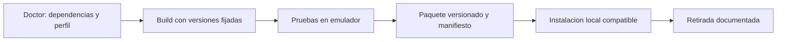

# Flujo reproducible y enfoque DevOps

Actualización 2026-10-15: el workflow Windows/sintético está implementado en
`.github/workflows/pc-rfcomm-offline.yml`. El historial completo se publicó
en [GitHub](https://github.com/Pizofh/Doomed---Doom-for-Redmi-watch-4-),
rama `main`. Las dependencias, firmware, WAD y datos privados permanecen fuera
de Git; `node tools/audit-git-publish.mjs` revisa los blobs históricos y valores
privados actuales sin imprimirlos. El texto siguiente conserva el plan original
de R73; sus afirmaciones de ausencia de workflow/remoto ya son históricas.

Propuesta para la dirección DevOps solicitada, 2026-10-04. Este documento es un plan: no hay todavía workflow de GitHub Actions, release publicada ni instalador físico. El repositorio sigue local sin remoto. R73 demuestra Doom persistente en el guest S3, no compatibilidad M2315W1.

## Qué falta antes del reloj

1. Identificar región/build del reloj y Mi Fitness, mediante lectura manual autorizada.
2. Demostrar un camino de instalación y ejecución suficiente en firmware stock M2315W1: paquete aceptado, runtime, ABI/exports, privilegios y memoria disponible. ELF S3 ligado a direcciones del guest no es un binario RW4.
3. Completar un plan concreto de retirada/recovery y riesgo para el primer paquete físico. No hay recovery validado para corrupción de sistema; reboot y factory reset no lo sustituyen.
4. Tras aprobación de cada acción: watchface conocida, hello/logging, display/touch/salida y DOOM al final. No existe autorización para ejecutar estos pasos ahora.

No estimar un porcentaje o fecha: la viabilidad de ejecución suficiente en stock es una incógnita técnica. [Gate detallado](physical-device-plan.md). La preparación de CI puede avanzar sin abrir ese gate.

## Flujo objetivo

**Doctor y entrada única.** Detectar herramientas, inputs/licencias/hashes y perfil compatible; ofrecer instrucciones precisas para obtener lo que falte. Mantener adquisición separada de ejecución. Unos pocos comandos equivalentes a doctor/build/test/package deben sustituir la necesidad de conocer todos los experimentos. Sus nombres y CLI aún no están implementados. Los scripts actuales son piezas reutilizables; `scripts/build.ps1 -Target Doom` tiene un gate histórico pendiente de actualizar para la UI ya validada.

**Build y perfiles.** Fijar revisión de doomgeneric, toolchain, flags y hashes de SDK/guest; partir de un checkout limpio. Separar `s3-emulator` de un futuro perfil `rw4-<firmware>` aprobado. Un manifiesto debe incluir commit, target, arquitectura/ABI, guest o firmware admitido, toolchain, hashes y límites. Verificar repetibilidad desde cero antes de afirmar igualdad binaria entre builds. No convertir bindings absolutos S3 en un SDK RW4.

**CI pública ligera.** En cada PR: sintaxis de tooling, locks y verificaciones que funcionen sin firmware/WAD/emulador. Validar contratos C/Lua con herramientas apropiadas cuando estén disponibles. Actions fijadas por SHA y token con permisos mínimos. No ejecutar experimentos al comprobar sintaxis de sus scripts. La compilación completa no puede anunciarse como CI pública autosuficiente mientras dependa de inputs propietarios y rutas locales.

**Pruebas de integración.** Runner Windows controlado y entorno aislado del emulador, con inputs obtenidos legítimamente y verificados. Ciclo START/E1M1/input/EXIT/reentrada y persistencia cuando el cambio lo requiera. Publicar reportes seleccionados de FPS/RAM/cleanup y capturas, nunca dumps indiscriminados, datos personales ni imágenes de firmware. PRs ajenos no acceden a ese runner ni a secretos. Este job queda pendiente; los helpers existentes prueban el emulador local.

**Paquetes y releases.** Paquete de aportes distribuibles, manifiesto de compatibilidad, checksums, listado de dependencias/licencias y guía de instalación/retirada. Cada release debe indicar qué dispositivo se probó. El WAD se adquiere por separado con revisión de licencia e integridad; no incluir firmware/emulador propietario. Resolver la licencia de aportes y obligaciones GPL antes de distribuir el motor enlazado. Un artefacto de CI puede conservar builds o reportes; una cache solo acelera y no acredita integridad.

**Instalación local.** Tras compatibilidad demostrada, preflight estricto del modelo/build, backup del contenido que sea respaldable, writes limitados a archivos propios, verificación posterior y retirada. Actualizaciones deben definir cuándo conservar WAD/config y cómo recuperar la versión anterior. El usuario conserva el control del primer paso físico y de cualquier acción de riesgo. No prometer instalación con un clic hasta demostrar ese flujo en una unidad real.

## Orden práctico

Prioridad inmediata: investigar el mecanismo stock específico M2315W1. Primer checkpoint DevOps: entrada única doctor/build/package para el perfil del emulador y prueba desde un checkout limpio; después CI ligera e integración. La automatización no sustituye la investigación de plataforma.

Valor de portfolio: cross compilation, dependencias fijadas, aislamiento del entorno de pruebas, manifiestos de compatibilidad, métricas, trazabilidad de releases y rollback. Presentar hoy “Doom original en emulador Xiaomi S3”; reservar “port a Redmi Watch 4” para evidencia física.

Referencias oficiales: [artefactos de GitHub Actions](https://docs.github.com/en/actions/concepts/workflows-and-actions/workflow-artifacts), [seguridad y dependencias de Actions](https://docs.github.com/en/actions/reference/security/secure-use). Pipeline aún no ejecutado en GitHub.
