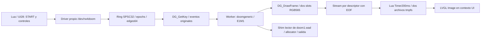

# R67: DOOM original con pantalla y controles

El 2026-10-04, doomgeneric ejecutó E1M1 dentro de nuestra página Lua/LVGL del emulador Xiaomi Watch S3 a390×450. Avanzar, girar a ambos lados, disparar, pausar/reanudar y dos ciclos START/EXIT/reapertura pasaron. No hubo reboot para salir. El Redmi Watch 4 M2315W1 físico sigue intacto; esta prueba no determina su ISA, ABI, APIs, memoria o privilegios.

## Resultado reproducible

Artefacto local ignorado: `artifacts/emulator/doom-ui-test-1791143272849/result.json`, `passed=true`. Las24 observaciones, ocho capturas, dos archivos RGB565 y marcadores completos quedan junto al resultado o en `artifacts/emulator/screenshots/doom-ui-test-1791143272849-*.png`. Inspección visual: E1M1 original, escenario, arma y HUD correctos, dentro de la página con MOVE/FIRE/MENU.

| Comprobación | Resultado |
|---|---|
| Motor y datos | doomgeneric dcb7a8dbc7a16ce3dda29382ac9aae9d77d21284, doom1.wad shareware R63 |
| Motor en worker | Workers104/408, owner UI28, init NSH88/407; detach0, stack solicitado32768bytes |
| Avanzar | Posición fija16.16 cambió; inicial x1056/y−3616, tras avanzar x≈1055.9/y≈−3389.4 |
| Girar | Ángulo del jugador cambió con LEFT y RIGHT |
| Disparar | Munición50→47, health100; ocho edges entregados al motor en primer ciclo |
| Soltar | requested/applied/delivered_keys0, queued0, epoch=ack |
| Pausa del menú | Tic, posición, ángulo, munición y contador de dibujo idénticos en dos muestras separadas; siguen avanzando tras RESUME |
| Frame completo | Los64000 píxeles del screenshot coinciden con una copia RGB565; tolerancia7 por canal al expandir565,167 colores |
| EXIT | Stop cooperativo reason1, worker ausente antes de unload, refs/readers/input0; módulo/nodos/copias retirados |
| Reapertura | ELF descargado y cargado de nuevo; posición/ángulo iniciales y munición50 restaurados, otro worker; sin reenviar archivos |
| Recursos propios | Por ciclo13alloc/13free, streams0, cleanup0; pico6582961bytes de payload del motor |
| Entorno normal | Tras ambos EXIT se abrió panel/Ajustes y se seleccionó Storage365700764; no reboot para salir |

La métrica `delivered_keys` representa los edges entregados por el adaptador, no lectura del array privado `gamekeydown` de Doom. Posición, ángulo y consumo de munición prueban que el motor procesó las acciones. La pausa entrega KEYUP y ejecuta `D_ProcessEvents` únicamente en un límite entre Ticks antes de confirmar neutralidad.

## Arquitectura ejecutada



`adapter.c` implementa DG_Init, DrawFrame, SleepMs, GetTicksMs, GetKey y título. Conserva motor, renderer y gameplay upstream; no se implementó un juego alternativo. Se reutilizó el core revisado R66, sin recompilar80C ni repetir sus ensayos. Runtime R65 conserva ownership de reservas/streams y salida `setjmp`/`longjmp` en el mismo worker.

`transport.c` deriva de R62. El initializer registra dos drivers y retorna; START desde Lua crea y desacopla el worker con stack32KiB. El worker no llama LVGL ni espera a la UI. Dos slots FREE/WRITING/READY/READING impiden sobrescribir un frame en lectura. Un lector posee posición/slot por descriptor, cierra y libera; no usar `cat` sobre el nodo de control sin EOF.

Snapshot:192bytes/48words. Primeras32 conservan R62;16 métricas añaden tic, callbacks, gamestate, episodio/mapa, x/y/ángulo, munición/vida, delivered_keys, wall_ms y pico/alloc/free/cleanup post-run. Es una muestra de words atómicos, no una transacción completa.

Stream:128028bytes =16 metadata (magic/generation/tic/FNV de píxeles),12 header LVGL y128000 RGB565LE. Lua escribe solamente el header y los píxeles a dos nombres fijos, invalida sus caches en UI antes de reutilizarlos y mantiene LVGL separado de la memoria del módulo. Imagen320×200 en x35/y40; pad210×140 en x20/y285, FIRE125×85 en x245/y285, MENU125×40 en x245/y385. Un dedo; avanzar+girar por desplazamiento dentro del pad. Movimiento y disparo simultáneos, USAR y corona todavía pendientes.

Pausa: invalidar epoch/liberar keys, finalizar Tick actual, procesar KEYUP, confirmar neutralidad y esperar20ms sin ejecutar otro Tick. El reloj DG descuenta el tiempo pausado para evitar catch-up al volver. RESUME exige input neutral y un contacto nuevo. EXIT elimina Image/invalida caches en UI, solicita stop y espera mediante Timer; no join/sleep en UI. Un nuevo START requiere unload/reload para restaurar globals de Doom. GC conserva el mecanismo R62 de stop/retención/recolección al reentrar; ese cierre sin EXIT no se repitió con el motor en R67.

## Medición y límites

Ventana de2534ms:89tics (~35.1/s),13 frames producidos (~5.1/s) y178 callbacks (~70.2/s). **Callbacks no son FPS visibles.** Timer200ms limita la presentación a unas cinco imágenes por segundo y dos slots bloquean producción cuando están ocupados. La medida de produced tampoco cuenta presentaciones exactas ni excluye los slots ya pendientes. No hay todavía FPS de presentación instrumentado, CPU, latencia ni coste de copia/conversión medidos. La imagen es320×200 sin corrección de aspecto; la fluidez inicial requiere mejora.

Pico de payload del motor6582961bytes (~6.28MiB), además de secciones: `.text`130312, `.rodata`100920, `.data`60004 y `.bss`501992, total793228bytes. No incluye stack32KiB, loader/libc/Lua/LVGL/cache, WAD4196020 en tmpfs, ELF446144 y dos copias de128012bytes. Esto no demuestra que quepa en la RAM del RW4 físico.

Dos muestras globales `free`: Umem used22806040→23043040 (+237000), maxused26653356→34845460 (+8192104); nused511→510/nfree70→68. GImageCache used1106856/nused67/nfree13 igual. Aunque los recursos propios del motor quedaron en cero, la diferencia global tiene causa no aislada; no afirmar ausencia de fugas del guest ni uso máximo exclusivo de Doom. No se midió estabilidad prolongada.

Sesiones finitas: límite120s de reloj real, incluidas pausas, y10000Ticks. Poll cooperativo en DG; no hard watchdog ni recuperación frente a corrupción/crash. E1M1 únicamente: el adaptador termina si cambia de nivel/estado; sonido, saves/config writes y otros mapas no habilitados. Writes del core siguen denegadas por el shim. Las pruebas de R67 usaron menú y pausa nativa controlada para capturar; panel stock durante Doom, stop con FIRE aún mantenido y pérdida de foco real durante contacto quedan como siguiente gate del motor, aunque el transporte anterior R62 sí se probó por separado.

## Revisión y reproducción

Guest fijado SHA849a04f6d461938022ffb820143f870be7e91933b3fb538d009b24c7fa6098fa. ARM Cortex-A7/Thumb/EABI5/hard-float, FLAT, direcciones de45 imports exactos del guest. Módulo ELF446144bytes, SHAe115971e75ec32f33e2ee63a3c2af9799b8d207f73c3779db3bb31b53cef9639, entry0x1fc61. Fuente propia combinada normalizada LF: d6fd905b95929cd857df3693db6ca9c199f197c03ff7133d73d5752a3fbb3353.6993ABS32+4THM_CALL autorrecursivos permitidos por la revisión R66. Sin UND/COMMON. Core cached SHA50d8fb8911766fb0285eedd81e3965be7b923562c7a3782abd87e068c6a21c8e; flags/sources/overlay verificados antes de enlazar adaptador/transporte.

Lua SHAb86f0cee70c58a544a09c5069c4c4fcd260a9ebb4b0b05deb827507d9d7120d9, paquete19576bytes SHAec1cf33c1e236a5682684fc9b2d6d8578c5acfd8b7090935a5cd5fa689d52143. Compiler original revisado, sin ADB junto a él; packaging local solamente. Instalación `refresh` con UIProbe inactiva, backup/readback del paquete y derivado, sin reset de instalación.

Hubo **un reset de baseline antes de ejecutar C**, por SCREEN_STATE_OFF del guest tras inactividad. Pulsación larga no lo despertó; evidencia previa y copia de data en `doom-ui-baseline-reset-1791143049777`. El staging previo se perdió por ser tmpfs; se repitió después de comprobar boot/UI responsive. No hubo crash ni fracaso de la prueba final. Un generador host inicial rechazó un campo residual antes de escribir Lua; no llegó al guest ni cargó C.

```powershell
node tools/build-doom-ui.mjs
node tools/package-ui-probe.mjs doom
# UIProbe inactiva, módulos propios ausentes; refresh exige derivado existente.
node tools/install-ui-probe-emulator.mjs refresh
# Emulador activo y responsive; si necesita reset, hacerlo antes de stage.
node tools/doom-ui-emulator.mjs stage
# Seleccionar UIProbe por Ajustes; revisar cada pantalla y Ready, sin START previo.
node tools/test-doom-ui-emulator.mjs
# Seleccionar Storage después de EXIT; el host no descarga C ni limpia caches.
node tools/doom-ui-emulator.mjs cleanup
```

Builder reutiliza core verificado si existe; un entorno limpio necesita los inputs revisados R63/R64/R65 y genera ese core primero. Helpers cotejan QEMU/ADB/guest/ELF/fuentes/ID y usan exclusivamente loopback5039/emulator-5554; ninguna ruta a USB o hardware. El preflight comprueba también WAD remoto; cleanup verifica WAD intacto antes de retirar su copia fija. Si worker/referencias/error no permiten unload, conservar estado para inspección, nunca kill/rmmod forzado.

Final: Storage365700764, UIProbe365799903 instalada modo `doom`, C retirado y tmp propios ausentes. WAD/ELF se retiraron en `doom-ui-cleanup-1791143492626`; no persisten tras reset. La reapertura entre dos ciclos no necesitó PC, pero **esto todavía no es una instalación persistente de Doom**. Módulo FLAT sin sandbox; no reutilizar binario/direcciones en M2315W1.

Siguiente checkpoint: comprobar foco del panel stock y salida con FIRE mantenido mientras ejecuta el motor real, antes de mejorar transporte/rendimiento o investigar persistencia.
