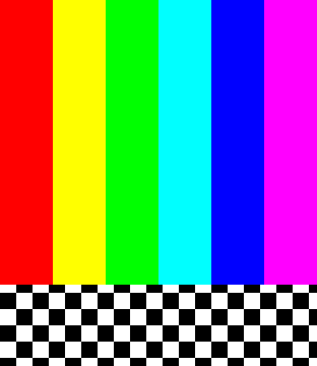

# Patrón de display desde C: emulador

2026-10-03. Un módulo C propio mostró barras RGB565 y un tablero en MiWatchEmulator v1.0 / guest Xiaomi Watch S3 a 390×450. En la prueba con pantalla activa, restauró los píxeles, liberó sus recursos y se descargó; touch y navegación stock funcionaron después **sin reiniciar**. No se probó M2315W1 ni DOOM.



La imagen anterior contiene únicamente nuestro patrón, sin assets de watchface ni firmware. Las capturas stock y logs completos permanecen en artifacts ignorados.

## API y formato comprobados

Antes de escribir píxeles, `probe.c` abrió /dev/fb0 con O_RDONLY, consultó VIDEOINFO/PLANEINFO y cerró el descriptor. Los buffers de respuesta se sobredimensionaron; el desensamblado del driver confirma copias de 8 y 28 bytes. Fuente de referencia: [NuttX fb.h fijado](https://github.com/apache/nuttx/blob/8fdb56b5f2124de351a48125a252ba4264665e3d/include/nuttx/video/fb.h), contrastada con el guest, no asumida como versión exacta.

| Campo | Resultado local | Interpretación |
|---|---|---|
| Resolución visible | 390×450 | Preset del emulador, no prueba física |
| Formato | 11 / FB_FMT_RGB16_565 | RGB565, colores comprobados visualmente |
| Planos | 1 | Una superficie de color |
| Bpp / stride | 16 / 780 bytes | 390 píxeles por fila |
| Superficie virtual | 390×900 | Dos pantallas de 450 filas |
| Memoria de framebuffer | 702.000 bytes | Dos buffers de 351.000 bytes; no RAM libre de apps |
| Consultas / close | 0 / 0 / 0 | Completadas sin escritura de píxeles |

Estos valores solo describen el driver Goldfish del guest. No asumir /dev/fb0, double buffering o permisos equivalentes en el RW4.

La configuración compilada identifica LVGL 9.0.0 con extensiones, profundidad 16, backend libuv y `CONFIG_LV_USE_OS 0`. También contiene un período configurado de vsync de 33 ms, que **no es una medición de FPS**. Hay símbolos LVGL nativos; su presencia no define un contexto válido para llamarlos desde NSH.

## Comparación de caminos

| Camino | Ventaja | Pendiente / riesgo | Decisión para esta prueba |
|---|---|---|---|
| LVGL | Puede compartir widgets, input y lifecycle de la UI | ABI de la variante, hilo de UI y sincronización; LV_USE_OS=0 no aporta un mutex automático | No crear widgets desde NSH aún |
| Framebuffer | Driver y geometría consultables; conversión RGB565 sencilla | Buffer compartido con stock; falta ownership exclusivo y arbitraje de presentación | Patrón temporal y controlado, no backend final |

## Programa y salida

`pattern.c` usa O_RDWR sin create/truncate; exige la geometría exacta observada, verifica puntero/alineación y reserva 702.000 bytes para respaldar ambos buffers. Dibuja dentro de esos límites y solicita presentación mediante FBIOPAN_DISPLAY (0x2818), contrastado con el driver y el backend stock. Solicita hasta ocho segundos mediante veinte sleeps de 400 ms; una interrupción puede acortar la ventana.

Después restaura los buffers y solicita presentación, libera el respaldo y cierra el descriptor antes de retornar. El host comprueba lsmod, ejecuta rmmod y elimina únicamente el ELF temporal verificado en /tmp. No hay tareas, callbacks, timers propios, mmap pendiente ni recursos retenidos que requieran un uninitializer. El módulo continúa siendo código FLAT con acceso al sistema, no sandbox.

El enlace se deriva exclusivamente del ELF guest fijado por SHA256, como en el [hello C](hello-native-emulator.md). No utilizar direcciones de otro S3, otro firmware o BES2700. Las únicas relocations del payload son R_ARM_ABS32. Las pruebas modifican memoria de display y estado transitorio del driver del emulador; no escriben almacenamiento persistente del payload ni particiones.

## Evidencia y limitaciones

| Prueba | Resultado | Artefacto local |
|---|---|---|
| Inquiry desde C | Queries/close=0, geometría anterior | display-probe-1791046352095 |
| Primer patrón | Visible; restauración de PNG exacta; módulo descargado | display-pattern-1791046690835 |
| Patrón con pantalla activa | Visible; show/pan/close=0; PNG antes/después idénticos | display-pattern-1791047135460 |
| Touch antes de la segunda prueba | Arrastre produjo release x:7,y:3 | screenshots/display-touch-before-second-pattern.png |
| Touch después | Tap produjo release x:0,y:0 | screenshots/display-touch-after-active-pattern.png |
| Navegación posterior | Panel stock abrió por swipe | screenshots/display-stock-panel-after-active-pattern.png |
| Descarga | lsmod solo muestra encabezado; uname responde | 08-lsmod-unloaded.json y 10-uname-after.json en cada prueba |

Carpetas bajo artifacts/emulator. Logs de la segunda prueba:

```text
RW4_FB_PATTERN: visible pan=0 bytes=702000
RW4_FB_PATTERN: restored show=0 pan=0 close=0
```

En la segunda prueba, SHA256 del PNG tanto antes como después:
`a521467ff2b5bfd9988b509c62a7310e0fcf4eabe86ce800dcb9a8466dabfe2e`.

La primera comprobación de gestos no actualizó la UI. Los logs documentan ON→OFF por inactividad a las 15:48:36, antes del patrón. Un intento de tecla Power no produjo un wake observable; no se conserva como comando soportado. Se reinició el guest solo para establecer un baseline activo y comprobar touch antes de repetir. La segunda prueba devolvió UI e input sin otro reboot. No se atribuye un crash o corrupción al primer patrón.

Una captura puede conservar los últimos píxeles aunque la UI esté pausada: no basta para demostrar actividad. No deshabilitamos power management ni instalamos un wakelock persistente.

El framebuffer sigue compartido con LVGL: stock puede repintar durante la ventana, y restaurar una copia puede recuperar píxeles antiguos si cambió la UI. No se probaron animaciones/eventos concurrentes, modos de pantalla distintos, FPS, latencia, copy cost, heap pico, fugas prolongadas, ni restauración tras fallo fatal. Los 702.000 bytes son el respaldo solicitado, no el consumo total. Esta es una demostración de display y devolución controlada sobre una watchface estática, no una app interactiva o ownership resuelto.

## Reproducción

Tras comprobar que TouchEvents está activo y responde a un gesto:

```powershell
node tools/build-display.mjs probe
node tools/run-display-emulator.mjs probe
node tools/build-display.mjs pattern
node tools/run-display-emulator.mjs pattern
```

No enviar inputs durante los ocho segundos del patrón. Después comprobar touch y panel stock, además de las capturas automáticas. Si la pantalla ya está OFF, establecer un baseline activo antes; no considerar un reset posterior al patrón como éxito del exit.

La build verifica herramientas/guest, binds, ELF/ISA/entry/relocations y los hashes de las fuentes y payloads ya revisados. Si cambia el programa o el resultado, marca contractReviewed=false y el runner rechaza cargarlo. El host selecciona solo emulator-5554 por el servidor 5039 con ownership comprobado y excluye hardware físico. Se respalda el disco con QEMU pausado antes de cargar; no es un backup de RAM ni prueba de consistencia del filesystem. Los binarios se mantienen ignorados.

ELF inquiry: 1.496 bytes, SHA256 `d7e40268059936c285504bbbf84ffe59fdf2562358b0c762745ddad041e39674`.
ELF patrón: 1.988 bytes, SHA256 `430c67fa9bad0c3be1c069608de88be91d8b0672db66aa5abfd9652969122bcb`.

Checkpoint posterior completado: [touch C sin consumir eventos de stock](native-touch-emulator.md). Resolver el contexto de UI/ownership sigue siendo requisito antes de un backend interactivo estable. Timers monotónicos, filesystem para WAD, launcher y DOOM pendientes. Gate físico cerrado.
