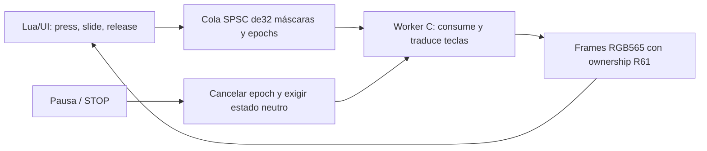

# R62: input mantenido consumido por worker C

Resultado al **2026-10-04**: nuestra UI Lua entrega estados de avanzar/girar/disparar a una cola concurrente acotada; el worker C los consume y sigue produciendo frames. Se comprobaron38 observaciones,22 eventos de tecla, cuatro imágenes completas, pausa con contacto mantenido, saturación, panel stock, dos EXIT, STOP con FIRE pulsado y cierre/reentrada. **Solo guest S3 de MiWatchEmulator; no Doom, WAD ni M2315W1 físico.**

## Diseño

Experimento separado `experiments/native-worker-input/`, conservando fuentes/pins R55 y R61. Reutiliza el [ownership de frames R61](native-worker-frame-emulator.md), pthread detached y retiro por PID ausente. Image320×140 en x35,y50; MOVE210×170, FIRE125×100 y menú125×60. Menú con RESUME/EXIT; HOLD TEST y QUEUE TEST son instrumentación exclusiva del emulador.

Máscaras:1 avanzar,2 izquierda,4 derecha,8 disparo. Rechaza bits ajenos e izquierda+derecha. Un dedo; diagonal combina avanzar/girar. No corona, multitouch, USAR, atrás, disparo continuo ni movimiento+FIRE simultáneos. No se validó comodidad en muñeca.



La UI es el productor normal único y publica tail con release; el worker único observa tail con acquire, copia el registro y publica head. Cada registro ocupa8bytes: máscara y epoch. No se sobrescribe el slot antes de que el consumidor lo libere. Las transiciones de máscara se traducen en el worker a códigos UP173, LEFT172, RIGHT174, FIRE163 ya verificados en R55; primero releases, luego presses. Repetir una máscara no añade eventos. El diagnóstico registra **nxsched_gettid real del emisor**, no el ID copiado del estado. No hay implementación de DG_GetKey ni motor enlazado todavía.

La pausa/STOP ponen el gate, requested0 e incrementan el epoch. El worker descarta registros de epochs anteriores, emite releases de su estado aplicado y publica ack. No se borra la cola desde el productor. Un overflow pausa y cancela por este mismo mecanismo, sin escribir fuera del ring ni sobrescribir órdenes. Resume requiere requested/applied0, cola vacía y ack del epoch actual; el Timer espera ese estado, sin dormir/join en la UI. Volver del panel deja el menú pausado hasta RESUME explícito y contacto nuevo.

La cancelación es cooperativa. No se promete pausa instantánea de una instrucción C en curso; la prueba espera la confirmación neutral. El presupuesto finito aumentó a3600 esperas nominales de50ms, aproximadamente180s, para permitir pruebas de controles. Sigue sin ser watchdog ni duración garantizada.

Al terminar, el worker cierra accepting y espera fuera de UI, de forma acotada, una publicación ya iniciada (producer_busy). Si no termina, registra error y conserva condiciones que impiden descargar. Después descarta la cola y libera teclas. Esa rama de fallo no se inyectó. Uninit exige cero descriptores, productor inactivo, requested/applied0, cola vacía y worker retirado/PID ausente. GC solo pide STOP y conserva código/copias; reentrada limpia caches y descarga desde UI. No llamar LVGL desde worker, GC, NSH o uninit.

## Interfaz del prototipo

Módulo `rw4winput`, control `/dev/rw4winput`, stream `/dev/rw4wistream`, payload `/tmp/rw4-worker-input.elf`. Dos copias `/tmp/rw4-worker-input-0.bin` y `-1.bin`; solo tmpfs, sin persistencia nativa.

El control admite snapshots64/80/128bytes sin EOF: **no cat/read-all**.128bytes conserva los20 words R61 y añade requested,applied,queued,changes,overflows,cancels,epoch,ack,consumed,key_events,accepting,producer_busy. Son cargas independientes, no snapshot transaccional. Normalmente los lifecycle writers se serializan en nuestra UI; no es contrato general de múltiples productores, shared FD, open/unload concurrentes o SMP.

Comandos1–7 de12bytes conservan R61. Op8 tiene16bytes: magic `0x34574c52`, seq creciente,8,mask. Input y cache-drop comprueban caller UI owner; no publicar input desde CLI. El rechazo por caller incorrecto se revisó estáticamente, sin prueba negativa en R62. El STOP de la prueba mantenida usa op2 permitido desde NSH, con secuencia leída inmediatamente y retry acotado si hay EINVAL; **no descarga ni ejecuta cache/LVGL desde el host**. Ese ensayo concreto no demuestra seguridad general de writers concurrentes.

Los frames conservan header12 y89600bytes RGB565. Las primeras8 filas codifican generación; las siguientes8 muestran los cuatro bits del estado aplicado en barras verdes/negras. Las restantes son el patrón de colores/tablero. La captura valida44800 píxeles contra generación y máscara decodificadas del frame, sin asumir snapshot C e imagen simultáneos. Lua cierra el stream antes de otros comandos y LVGL recibe rutas propias, nunca punteros a memoria del módulo.

## Resultados

Artefacto principal: `artifacts/emulator/worker-input-test-1791131669210/result.json`, passed=true.

| Ensayo | Observación |
|---|---|
| Worker/UI | UI28; workers439/791 después de init; los22 key edges tienen el ID real del worker correspondiente |
| Mantener avanzar | changes1/consumed1/key_events1 estables; steps50→90 y produced17→29, sin repetir presses |
| Deslizar/soltar | FWD+LEFT, FWD+RIGHT, RIGHT, neutral, LEFT y FIRE; releases coherentes; salir de la zona cancela |
| Pausar aún pulsado | HOLD TEST deja requested/applied0, paused1, epoch/ack3 y cola vacía mientras el ratón sigue down |
| Panel stock | Gesto desde195,440; panel visual confirmado; steps373/produced115 constantes y estado neutral; regreso sigue pausado |
| Saturación |32 transiciones aceptadas antes de overflow; changes15→47, consumed15 estable al descartar; overflows1, epoch/ack7, cola/teclas0 |
| Volver del overflow | FIRE nuevo se consume correctamente; ninguna acción anterior se restaura |
| Display | Cuatro capturas completas,44800 píxeles cada una, estados0/1/8/0; sin mezcla observada |
| Dos EXIT | Workers439/791, módulo, ambos nodos y copias desaparecen; key masks reconstruidas del log terminan0 |

Prueba adicional `worker-input-held-stop-1791131823074`: worker885 con requested/applied8 y ratón aún pulsado recibe STOP cooperativo. Se observa FIRE down1→down0 y uninit0 con requested/applied/queued0, worker ausente. UI retira caches/copias; ningún rmmod/kill host ni reboot. El guard de launcher añadido al helper se validó aparte, read-only, en `worker-input-guard-1791131900795`; no modifica el protocolo C probado.

Cierre sin EXIT: `worker-input-close-1791132028553`, worker968 stop1/reason1/live0,93 pasos,30 frames, epoch/ack3 y estado neutro. Módulo/copias retenidos hasta `worker-input-reentry-1791132117672`, donde UI recoge todo. Final `worker-input-final-1791132187928`: Storage365700764, PIDs104/439/791/885/968 ausentes y todos sus marcadores uninit0/reason1/live0/refs0/requested0/applied0/queued0. ELF y copias propios retirados; watchface propia sigue almacenada en modo winput. Captura `artifacts/emulator/screenshots/worker-input-final-storage.png`.

## Intento fallido y límites

Primer runner `worker-input-test-1791131537341` pasó los controles y HOLD TEST, pero esperaba abrir el panel con swipe195,410→195,40. Ese inicio cae dentro de MOVE con PRESS_LOCK: recibió el contacto y lo canceló al salir del rectángulo, sin abrir panel. Se observó UI viva, input neutro y worker104 sin error; salió mediante menú/EXIT, sin reset. El runner ahora usa el margen libre y comprueba visualmente el panel. No se alteró C ni Lua para corregir el gesto del test.

Hubo un reset inicial para actualizar/rescanear nuestra watchface, antes de C. El selector volvió a Neat; se revisaron previews hasta UIProbe antes de seleccionar. No asumir que el rescaneo conserva Storage, ni navegar Settings sin guards/capturas. Los helpers excluyen USB y verifican QEMU/imagen/ADB loopback5039/emulator-5554. Antes de START verifican source, hash del ELF remoto, ID activo y launcher propio.

Umem usado19251384→19412312 (+160928), maxused23949676→24046412 (+96736); GImageCache usado1115704→1719368 (+603664). Dos muestras incluyen navegación/recursos del sistema: no se aisló causa ni se descartaron fugas prolongadas. No FPS del motor, CPU sostenida, jitter, costo de copia o presupuesto RAM RW4 medidos. No se probaron crash, kill, agotamiento, fallos pthread/driver ni el límite natural de180s.

HOLD TEST prueba nuestra cancelación con contacto activo; STOP verifica parada con FIRE activo. **Pérdida real de foco stock con un dedo aún apoyado sigue sin demostrar**, igual que ergonomía/corona física. El módulo FLAT comparte memoria y privilegios; atomics y RAM-only no lo convierten en sandbox. S3 configurado390×450 sigue sin demostrar compatibilidad M2315W1/BES.

## Pins y reproducción

Arm14.3.rel1 revisado; mismos10 imports y guest SHA256 que R61. C17/Os/Cortex-A7/Thumb/hard-float/general-regs-only. ELF ET_REL32LE ARM EABI5, entry0xf1d,79 ABS32,8436bytes; BSS179620bytes (no RAM total/pico).

| Artefacto | SHA256 |
|---|---|
| Guest | `849a04f6d461938022ffb820143f870be7e91933b3fb538d009b24c7fa6098fa` |
| C normalizado LF | `28175b7cc88b126ad99fe9f3a29e837787af108e6ee044cf6cee6fb142ee675a` |
| ELF | `54facb91f2d27c3e1172bba174c3d2ac85a07343aa0ca2574f621a13e362f00c` |
| Lua | `090b7618d7bbca7150af4ba50aacb9443c19ce489ca48c927fda629af4c0fdb3` |
| Paquete20972bytes | `3da72d93acea9b2e5171aecaef42560bfd1eb4f59bbc1548326f67230836ae8f` |

Fuente propia y ELF exacto sustentan el nuevo protocolo. Referencias previas: [C lifecycle/cache/frames R61](native-worker-frame-emulator.md), [UI/events/doomkeys R55](native-controls-emulator.md), [tiempo R56](native-time-emulator.md). No se inspeccionaron nuevas APIs del firmware RW4 ni se ejecutaron binarios ajenos.

```powershell
node tools/build-worker-input.mjs
node tools/package-ui-probe.mjs winput
# Seleccionar Storage; UIProbe inactiva y módulos propios ausentes.
node tools/install-ui-probe-emulator.mjs update
# Esperar boot completo y confirmar respuesta UI; tmpfs se borra con reset.
node tools/worker-input-emulator.mjs stage
# Seleccionar UIProbe y revisar Ready, SIN START previo.
node tools/test-worker-input-emulator.mjs
# Desde launcher después de EXIT, con el mismo ELF aún staged:
node tools/test-worker-input-stop.mjs
# Para un cierre retenido, volver a UIProbe: Timer limpia caches/código.
# Luego seleccionar Storage y verificar ausencia de módulo/nodos/copias.
node tools/worker-input-emulator.mjs cleanup
```

No repetir la prueba pasada salvo cambios/fallos pendientes. Siguiente checkpoint único: **verificar procedencia/licencia de doom1.wad shareware y comprobar su lectura desde C en el emulador**. No incluir el WAD en Git ni ejecutar el motor antes de ese checkpoint. Gate físico cerrado; persistencia nativa, RAM prolongada y recovery/ABI M2315W1 pendientes.
